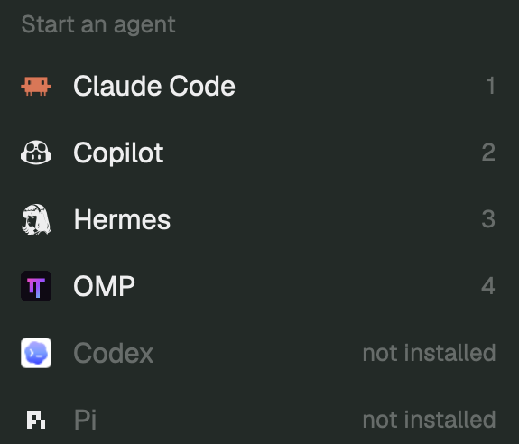

# OMP agents for Herdr

Read-only native OMP subagents and Tasks in Herdr's Agents sidebar, plus a native OMP launcher and official program icon. OMP owns execution; observation does not create substitute subagents, steer or cancel their work, or edit tasks. The launcher starts an ordinary OMP terminal through Herdr.



## Install

Give your coding agent this request:

```text
Read my Herdr app home's AGENTS.md, then install this integration:
https://github.com/RofieSagara/herdr-omp-observer/blob/main/RECIPE.md
Install the Herdr sidebar mod, the OMP observation extension, and the bundled launcher/icon configuration.
Preserve my existing layout and settings.
```

[RECIPE.md](RECIPE.md) is the installation and rebuild brief. It describes the UI, event/data contracts, collision handling, validation, and safe local/remote installation. No replacement layout or key-binding changes are bundled.

| Component | Install on |
| --- | --- |
| `mods/omp-agents/` | Each computer running a viewing Herdr window |
| `programs.json` merge snippet and `my-icons/omp.svg` | Each viewing Herdr client, preserving its existing configuration |
| `extension/` | Each execution host running the observed OMP profile |

For a local setup both runtime components live on the same computer. For a named remote machine connected through Herdr, the client needs the UI mod and launcher/icon configuration, not an OMP binary. The selected execution host needs OMP; Herdr checks and launches the registered command there. Installing on a host alone cannot configure an inaccessible client.

The OMP extension's default discovery location is `~/.omp/agent/extensions/herdr-observer/`; keep its three production files together. Profile/environment overrides can change that path. The UI belongs under the Herdr app home's `mods/` directory. `space-groups-agents` is not required; `space-groups` folder integration is optional.

Existing OMP sessions need `/reload` or a safe restart; fresh normal sessions discover the extension. Explicit `--no-extensions` launches need an explicit `-e` path. The extension is inert without a host-side `HC_TERMINAL_ID`. Plain `ssh host` typed inside a local terminal is not the named Herdr remote-machine path.

## Native launcher and icon

The bundled [programs.json](programs.json) adds the `omp` registration with default name `OMP`, `run: ["omp"]`, and the full-color [official SVG](my-icons/omp.svg). Merge that one entry; never overwrite a person's entire configuration. Preserve other programs, shell/interpreter settings, and intentional custom OMP launcher/profile arguments. See the recipe for icon-path collisions and safe merge rules.

Open **+ → Start an agent → OMP**. Detection, ordering, shortcuts, and launch location follow Herdr's existing menu; no custom tab bar or replacement menu is required. The same program registration supplies icons to OMP tabs, pane headers, and root Agents rows. OMP's own configuration still selects its model and credentials.

The unchanged artwork comes from [OMP's official repository](https://github.com/can1357/oh-my-pi/blob/main/packages/collab-web/public/favicon.svg), also served at [omp.sh/favicon.svg](https://omp.sh/favicon.svg). Keep `tint: false` to preserve the gradient. Its upstream MIT notice is included in [LICENSE-OMP](LICENSE-OMP).

## UI

Native hc children and observed OMP children share the existing tree layout. Native terminal rows keep their normal click actions; OMP-internal child rows are read-only and show task/model information in their tooltip. Completed, failed, and aborted OMP outcomes are retained for the current observed session. A completed child does not move its still-working parent into Done.

Each OMP parent has a checklist icon. Click it to expand TODOs below its children; click again to hide only TODO. There is no TODO separator. Phase names align with the parent agent icon. Each task has an L-shaped connector aligned with the start of its phase name, with compact spacing before its text. Each task occupies one line, truncates with an ellipsis, and has its status icon at the right. Hovering reveals only the full task content, without status or blocker notes. Screen-reader labels retain status information. The list preserves all five native states:

Empty or unavailable TODO data displays `No Task Yet`, including phases with no tasks.

- `pending`: open box.
- `in_progress`: spinner while the bridge is live.
- `completed`: check and strikethrough.
- `blocked`: attention icon/color.
- `abandoned`: dash icon, distinct from completion or failure.

A failed TODO tool call does not mark a task failed or replace the last canonical TODO list. TODO completion can automatically start the next pending task, following OMP's own normalization.

## Data and lifecycle

The extension binds to native child sessions and listens to `task:subagent:lifecycle`, `task:subagent:progress`, and `task:subagent:event`. Child identities supply direct parent lineage. Task outcomes come from task lifecycle signals, not merely `agent_end`.

A private atomic JSON snapshot is written under `~/.cache/omp-herdr/<terminal>-<pid>.json` with mode `0600`. Its absolute path is announced on that terminal's `omp.observer` hc label. Herdr polls linked files every 1.5 seconds through `readTextFile(path, { on: machine })`; no HTTP listener or additional network service is used. Main sessions heartbeat every 10 seconds; after 35 seconds without a heartbeat, rows show last-known stale state instead of live spinners. Graceful root shutdown marks the snapshot closed; child shutdown does not close its parent.

The wire format is version 1, scoped by terminal and root session ID. Session changes reset observed children and restore TODOs from the active transcript branch. Observation starts when the extension loads: old child events are not replayed. Manual/eval TODO edits are also discovered from the active branch. The bridge does not modify `shared.json`.

For remote machines, install the OMP extension where OMP runs and the sidebar mod on each viewing Herdr client. Snapshot paths are read on their owning machine through Herdr's existing connection. Current installation and native UI smoke were verified locally on macOS; remote connectivity was not exercised against a second machine.

## Verification

```sh
bun test
herdr-app check ~/.config/herdr-app/mods/omp-agents
```

Verified with OMP 18.16.0: real native scout execution, live TODO completion/auto-start transitions, mixed hc/OMP child rows, actual TODO icon clicks open/closed, completed strikethrough and all five TODO states, private file mode, graceful closed snapshot, and no Herdr runtime errors. Nested lineage, late lifecycle precedence, wrong-terminal/cyclic snapshot rejection, stale renewal, and changed-publisher async read isolation have behavior-level regression coverage.

The bundled native launcher and official icon were also exercised through the actual Start an agent menu: a ready OMP 18.16.0 session opened with the icon in the menu, tab, and pane header, without sending a model prompt. This local launcher smoke does not change the unverified second-machine remote boundary.

## Attribution

The sidebar retains the existing space-group sorting and native Agents behavior. Its upstream ancestry is documented in `NOTICE` and covered by `LICENSE-APACHE`. The official OMP artwork retains its separate upstream MIT license in `LICENSE-OMP`.
