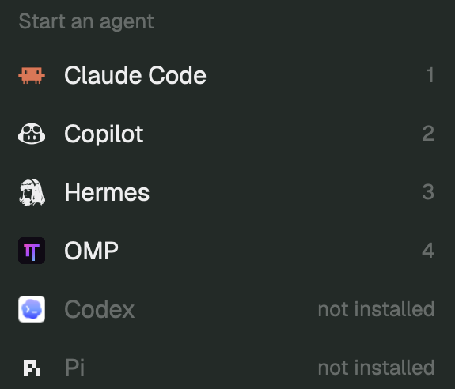

# OMP agents for Herdr

A Herdr Agents sidebar that presents native Herdr children and OMP's own subagents in a unified, collapsible Child agents section. Named task phases, such as Preview video, are separate collapsible sections. Rows are compact title-and-status-icon lines without tree connectors; one root disclosure shows or hides both children and tasks, expanded by default. The bundle also registers a native OMP choice in the existing Start an agent menu and supplies OMP's official full-color icon. It contains a Herdr UI mod, an OMP observation extension, and client-side launcher/icon configuration; it does not replace delegation or create substitute subagent terminals.



## What you see

- Retain the existing Agents sidebar: theme `chrome`, 13px base text, priority/space/folder sorting, pinned agents, collapsible groups, and native child terminal rows. Reuse the person's existing Agents block, not a replacement window layout.
- Main agent rows remain 30px high, with the program icon, agent/space detail, optional remote machine label, status, and existing pin/fold controls.
- An installed OMP choice appears in the existing Start an agent menu with the official gradient pi icon. Preserve the menu's row sizing and ordering; the shipped/current menu uses a 14px program icon. Herdr's program registry also supplies this icon to OMP tabs, pane headers, and root Agents rows. Keep its pink/purple/cyan gradient and dark rounded-square background; do not tint it to a single theme color.
- Native and OMP child rows share one flat `Child agents` section: 26px high, 12.5px text, muted title, 8px side padding, an 8px gap before a 12px right-aligned state icon, and no program icon or connector lines inside the child row. A running child spins; completed uses a check, failed/blocked an attention mark, aborted a dash, and idle a ring. Status words belong only in tooltips and accessible labels. Keep each owner's OMP namespace distinct even though the display is flat.
- One root disclosure shows or hides child agents and task phases together. Do not add a separate checklist/TODO icon. Root details and inner sections start expanded. Wrap each header and its expanded list in one card with a 1px theme `border` outline, 6px rounded corners, clipped contents, 6px top margin, and 4px bottom margin. The dropdown header is 28px high with 8px side padding, theme `surface` background, and 11.5px semibold text. Its title is on the left, with a single 12px expand/collapse chevron on the right: down when open, right when closed. Do not draw a second border around the header. The expanded body has a 1px top divider and 4px vertical padding; when closed, omit the body and retain the bordered header. No header status icon, spinner, or left chevron remains. Use `Child agents` for children and the canonical phase name for task sections; unnamed phases use `Unnamed phase`.
- Child titles and task text align to the root program icon's left edge. Tasks remain 26px-high, one-line, 11.5px text with no L or other tree decoration. Long content truncates with an ellipsis. Status icons stay at the right; completed task text is struck through. Task tooltips contain only the full content.
- Task marks: pending is an open box, in progress is a native spinner while live, completed is a check, blocked is an attention mark, and abandoned is a dash. Use the current theme's muted/status colors. Do not invent a failed TODO state: OMP's five task states are `pending`, `in_progress`, `completed`, `blocked`, and `abandoned`.
- Missing or empty task data says exactly `No Task Yet`, including a phase with no tasks. Retained stale or closed snapshots are visibly last-known data; they must not display live activity spinners.

## How it behaves

- Clicking OMP in the existing Start an agent menu creates a normal OMP terminal in the selected space on its owning machine. It uses the registered command and the person's OMP configuration, not a synthetic child, a bundled model, or a pinned author profile. Availability and numeric shortcuts follow the existing menu's installed-agent detection/order. A missing OMP executable is not fixed by the icon or the observation extension.
- Root statuses follow Herdr: working is a 12px rotating ring in the theme's working color; blocked is a themed `!` badge in compact/priority rows or `Needs you` pill otherwise; done is a filled 7px dot; idle is a 7px outlined ring. Priority order is blocked, done, working, idle. Keep a viewed Done row in its section until focus leaves, rather than moving it under the pointer.
- Clicking a root focuses its pane. Hover replaces its elapsed duration with a pin button; pin clicks stop propagation and retain existing pin behavior. The root disclosure and root program icon toggle child agents and all task sections together, without focusing another pane. When folded, show the combined child/task count and retain the child urgency color. Ordinary priority/space/folder group headers keep their existing folding behavior.
- The 41px Agents header has a sort button opening a 200×171px popup with Priority, Grouped by space, and Grouped by folder choices. Choosing one updates shared sort state and closes the popup. Group headers are 30px high. The scrolling list fills the remaining height.
- A sidebar narrower than 160px becomes a numbered rail: 26px root rows with compact status and the same combined disclosure where details exist. Child/task content stays hidden in the rail; widening it restores the current fold choices. No new key bindings are required.
- Clicking `Child agents` folds only child rows, not task phases. Clicking a phase folds only that phase's task rows, not children or another phase. Root hide/show preserves inner choices. The whole dropdown header, including its right chevron, is clickable; clicks in the bordered body do not fold the section. Section clicks stop propagation and never edit TODOs. Header styling is status-neutral. Child/task rows retain their own state icons, and stale running data must not spin.
- Native Herdr child rows keep their existing terminal-peek behavior. Internal OMP child rows are observation-only: no synthetic terminal IDs may be sent to Herdr's focus, peek, keep, kill, or messaging commands.
- Preserve priority, grouped-by-space, and grouped-by-folder views. `space-groups` is optional: read its shared state when present, otherwise keep the ordinary ungrouped list. `space-groups-agents` is not a required runtime dependency; its adapted UI is already included.
- Keep native child tree order, grouping, pinning, and agent keyboard navigation. A completed OMP child must not move its still-working parent into Done. Keep completed and failed children visible until a previously unseen child arrives in the same OMP session; then hide only previously observed completed and failed children. Preserve outcomes first observed in the new batch until a later arrival. Aborted, idle, and running children remain visible. Promote visible descendants past hidden ancestors rather than losing the descendants.
- OMP owns the work and its TODOs. Observe native lifecycle/progress signals, including child bindings; never wrap or replace `task`, eval agents, or workpool execution just to populate this UI. `agent_end` means a loop ended, not necessarily successful task completion.
- Changes to a session's canonical task list update the UI, including successful tool mutations and persisted manual/eval edits. Failed or pure `view` TODO results must not replace the last canonical mutation. Preserve automatic next-task activation as supplied by OMP.
- Start observing when the extension loads. Events from before that point are not replayed; do not promise reconstruction of previously running children. Session changes clear the previous observed children and restore task state from the new active transcript branch.

## Built from

### Package files

```text
RECIPE.md
README.md
preview.png
NOTICE
LICENSE-APACHE
LICENSE-OMP
programs.json
my-icons/omp.svg
extension/index.ts
extension/state.ts
extension/transport.ts
extension/state.test.ts
mods/omp-agents/main.js
mods/omp-agents/observer.js
mods/omp-agents/mod.json
tests/observer.test.js
tests/details.test.js
```

The checked-in files are one build of this brief, not prerequisites for rebuilding from an empty folder. Use the installed Herdr and OMP APIs and the contracts below; no author's private setup is required. This recipe is not an executable OMP plugin manifest and does not by itself make `omp install <url>` work.

- The Herdr view is a GPUI JavaScript `View`, using `gpui-kit`, `gpui-base`, and the installed `herdr` module. Its metadata is `{ "place": "none", "title": "Agents + OMP" }`.
- `main.js` retains the adapted grouped Agents view and uses `observer.js` for snapshot validation and visible-child projection. Read `agents()`, `terminals()`, `panes()`, `spaces()`, `focused()`, `theme()`, `layout()`, and shared state. Use only the shipped `mods/workspace-chrome/` spinner, chevron, sort, and pin art; the standalone TODO SVG is obsolete. Do not import another mod's code at runtime.
- A normal view needs no props. The same mod serves `props().sortMenu === true`. Preserve sort, pin, navigation, focus, peek, and sidebar-width commands. Store per-view folded keys separately for root addresses, `children-<owner>`, and `phase-<owner>-<index>-<name>` so independent owners and phases cannot fold one another. An empty folded set means everything starts open. Keep per-view pin order and state timestamps in `localStorage`; disclosure choices are view-local. Collect nested native OMP owners' phases outside the Child agents fold, but inside the root's combined detail fold.
- The OMP extension uses `ExtensionAPI`, `pi.zod`, managed timers, and `pi.events.on` subscriptions for `task:subagent:lifecycle`, `task:subagent:progress`, and `task:subagent:event`. Every inherited extension binding contributes its own session's events. `ctx.agent` supplies direct child lineage; only the main binding owns the root snapshot's heartbeat and close.
- `state.ts` owns session-scoped child/task state. Lifecycle outcomes outrank late loop/progress observations. `transport.ts` serializes and coalesces atomic snapshot writes through private temporary files and rename. Observation failures must not stop the user's agent.
- Restore canonical tasks by scanning `ctx.sessionManager.getBranch()` from newest to oldest for `custom` entries of type `user_todo_edit` containing `data.phases`, or successful mutating `todo` tool results containing `details.phases`. Ignore errors and `op: "view"` results. Recheck this branch every 1500ms while the root binding is active, so persisted edits not emitted as ordinary tool events are included.
- Production extension files are `index.ts`, `state.ts`, and `transport.ts`; keep them together. They need no separately installed npm runtime dependency in the verified OMP binary.
- On the machine running OMP, write a private snapshot to `~/.cache/omp-herdr/<terminal>-<pid>.json`, mode `0600`. Publish its absolute path once on the owning core terminal using `hc label <HC_TERMINAL_ID> omp.observer=<absolute-path>`.
- Wire version 1 includes local `terminalId`, `pid`, root `sessionId`, `rootAgentId`, epoch-ms `updatedAt`, `closed`, observed `children`, and task `todos`. Child rows carry `id`, `parentId`, agent type, task summary, outcome, model, and update time. TODOs preserve `{ name, tasks: [{ content, status, blocker? }] }`.
- The Herdr reader finds `terminals()[i].labels["omp.observer"]` and reads that path through `readTextFile(path, { on: machine })`. Strip the `machine/` prefix only for checking the snapshot's local terminal ID. Poll every 1500ms with no overlapping read pass, ignore late reads from replaced publishers, and reject malformed, cross-terminal, disconnected, or cyclic trees. Keep heartbeats at 10 seconds and mark data stale after 35 seconds.
- Keep the raw validated snapshot for TODOs, lifecycle state, and canonical lineage. Maintain a separate visible child snapshot using reader-local seen/hidden child-ID sets scoped by publisher, session ID, and root agent ID. On an arrival, hide completed and failed IDs that were already seen; ordinary heartbeats must not restore them. Clear an ID's hidden state if it resumes a running, idle, or aborted state. Preserve this history through missing/invalid reads, reset it for a different publisher/session or mod reload, and discard it when that terminal leaves. Reparent only the presentation copy past hidden ancestors. Never rewrite the publisher's snapshot or remove/kill native terminals.

### Native launcher and official artwork

The root `programs.json` is a minimal merge snippet, not a copy of anyone's complete configuration:

```json
{
  "programs": {
    "omp": {
      "name": "OMP",
      "icon": "my-icons/omp.svg",
      "tint": false,
      "run": ["omp"]
    }
  }
}
```

Herdr's `knownAgents({ on: machine })` uses the `run` entry for availability and launching. Reuse the existing plus menu; neither a replacement tab bar nor a special launcher mod is required. Do not hard-code a five-agent list or a permanent numeric shortcut. If a personal menu does not use `knownAgents`, adapt only its agent listing using the installed Herdr API, preserving its other actions; clone a shipped menu before editing it.

`my-icons/omp.svg` is the unchanged official favicon from `can1357/oh-my-pi`, `packages/collab-web/public/favicon.svg`, also served at https://omp.sh/favicon.svg. It uses a 64×64 viewBox, dark `#0f0a14` rounded square, and `#ed4abf`, `#9b4dff`, `#5ad8e6` gradient. Draw it as the program's full-color image (`tint: false`). Preserve the upstream MIT license in `LICENSE-OMP` and the source credit in `NOTICE`; the existing Apache notice does not replace that license.

### Install components, launcher, and icon

First read the running client's generated Herdr `AGENTS.md` and type files, plus this recipe and the relevant source files. Inspect the current layout and OMP profile; do not assume the author's personal layout name, paths, machine aliases, or terminal addresses.

Before installing, explain that the extension runs `hc label` and writes private local snapshots outside its code folder. The mod reads those linked files locally or through Herdr's existing remote connection. Choosing the bundled launcher starts the real `omp` executable on the selected space's machine. The bundled icon is local; no runtime icon download, added HTTP listener, cloud endpoint, or telemetry service is used. Snapshot content can contain task text and model names and must not be published.

1. **Identify the two installation targets.** The client is the computer running the Herdr window. The execution host is where the observed OMP process runs. They may be the same computer.
2. **Install the UI on each viewing client.** Copy `mods/omp-agents/` into that client's Herdr app home's `mods/` directory (default `~/.config/herdr-app/mods/omp-agents`). Include `NOTICE`, `LICENSE-APACHE`, and `LICENSE-OMP` with the installed bundle. Do not install the UI only on a remote execution host that has no viewing Herdr window.
3. **Install the extension on each execution host.** In the active OMP profile's `extensions/` directory, create a `herdr-observer/` folder containing the three production extension files. The default location is `~/.omp/agent/extensions/herdr-observer/`; named profiles, `PI_CODING_AGENT_DIR`, and initialized XDG layouts can change the actual location. Alternatively link that folder to a persistent checkout's `extension/` directory on the same machine. Never link to a disposable download directory or a path that exists only on the client.
4. **Respect collisions.** Never silently overwrite a person's existing mod or extension. If an unrelated `omp-agents` mod owns the name, choose a new folder name and rewrite the mod's `MOD` value, its own `mods/omp-agents/` asset paths, and the layout reference. For an extension-name collision, choose a free extension folder name. An update of this package must leave exactly one active copy of the observation extension; two copies would both publish the same terminal snapshot. Preserve user edits or ask before replacing them.
5. **Connect the client's sidebar.** Use `herdr-app status` to identify the selected layout. If it is shipped/read-only, clone it through `layout.clone` first so Herdr preserves its click/look state. In that personal layout, replace only the existing Agents block's `content.mod` with `omp-agents` (or the selected collision-free name). Keep block IDs, sizes, placement, frame, appearance, keys, spaces, and unrelated panels. Do not require `space-groups`, `space-groups-agents`, `auto-tabs`, or a particular personal theme. Do not copy the author's layout, `shared.json`, `data/`, `view.json`, or `layouts/.state/`.
6. **Merge the client's launcher and icon.** Copy the bundled artwork to that client's app home at `my-icons/omp.svg`, outside Herdr's rewritten shipped `icons/` folder. If that path contains unrelated artwork, choose a free custom path and update only `programs.omp.icon` accordingly; identical existing artwork can be reused. Merge the `omp` program entry into the existing `programs.json`, or create it from the snippet if absent. Preserve every other program, shells, interpreters, unknown top-level keys, and deliberately customized valid OMP name/run/profile arguments. Add missing default launcher fields; use the official icon path and `tint: false`. Never replace an entire existing file with this snippet or discard an invalid file to hide a parse error. Check the installed schema and report/resolve actual conflicts rather than guessing the person's intent.
7. **Activate safely.** Run `herdr-app check <installed-mod-directory>`, then inspect the actual window and `herdr-app status`, including program-registration errors. Fresh ordinary OMP sessions discover the extension. Existing sessions need `/reload` or a restart, performed only when safe for their ongoing work. Explicit `--no-extensions` launches need an explicit `-e <extension/index.ts>` path. Do not restart the user's core or kill agents to activate this package.
8. **Verify data and launch behavior, not just installation.** Confirm OMP is detected on the selected execution machine, open the actual Start an agent menu, and launch a disposable normal OMP session without sending a model prompt. Observe its ready UI and full-color program icon; do not infer success from a parsed JSON file alone. On the execution host, confirm that an OMP launched by that machine's core has `HC_TERMINAL_ID`, that `hc` is available, that its `omp.observer` label points to a readable private snapshot, and that the snapshot matches that local terminal ID. For the observation component, spawn a small read-only native OMP child and observe its real lifecycle in the sidebar. Open/close Tasks, confirm long-content tooltips and completion icons, and preserve native child rows. Do not fabricate snapshot entries or substitute a new hc agent for this check.

### Remote installation boundary

For a named remote machine connected through Herdr, the **client needs Herdr, this UI mod, and the launcher/icon configuration, not an OMP binary**. The **host needs herdr-core, OMP, and this extension**. Launcher availability is checked on the selected machine; `run: ["omp"]` launches there through Herdr's normal route. Labels and snapshot reads travel through the existing Herdr machine connection; no snapshot syncing or extra tunnel is needed by this design.

If an installer agent runs only on the execution host, it cannot assume it can modify the client's files. Install the host component and provide the client-side recipe step, or use an explicitly available connection to the client. Do not claim both sides installed until both are verified. Never install Herdr UI files into a guessed remote home as a substitute.

Typing `ssh host` inside a local shell is not equivalent to starting an OMP terminal on a named Herdr remote machine. That shell does not automatically provide a host-side core terminal identity and label route. This package does not support that plain nested-SSH arrangement directly.

## Watch out

- Verified locally on macOS with **Herdr 0.1.12** and **OMP 18.16.0**. The cross-machine reader is implemented, but a second-machine SSH installation has **not** been exercised end-to-end. Validate it on the intended host/client before calling that installation verified. The current reader expects POSIX absolute snapshot paths; do not claim Windows execution-host support.
- The default launcher is a relative `omp` command, so it follows the selected execution host's supported shell/PATH and ordinary OMP configuration. Preserve intentional custom launcher/profile arguments. Aliases are not a substitute for a command Herdr can launch. Installed-agent checks may be cached for up to a minute; open a fresh menu and verify the actual host instead of clearing private shared state or adding a fake always-installed menu row.
- `programs.json` is only a merge snippet. A full-file replacement can erase the person's unrelated registrations and shell/interpreter settings. Keep the icon in a custom app-home folder and retain `tint: false`; a tinted SVG loses the official gradient. Do not force-install auto-tabs, a Zed menu, or a new layout to obtain this launcher.
- `space-groups` is optional shared-data integration, not a code dependency. The original `space-groups-agents` mod is unnecessary. Preserve its Apache-2.0 ancestry and modifications in `NOTICE`/`LICENSE-APACHE`.
- The extension is inert without `HC_TERMINAL_ID`. Keep core terminal IDs distinct from names, session IDs, and remote `machine/terminal` addresses.
- `pi.events` is scoped to its binding. A main-only listener is not a tree-wide guarantee; keep inherited child listeners and direct parent identities. Do not infer task completion from `agent_end`, or infer failure merely because a retained session is idle/closed.
- Canonical TODO restoration scans the active transcript branch, ignoring failed or pure-view mutations. Manual/eval changes may need the managed 1500ms branch scan. Never replace source task states with UI guesses.
- `No Task Yet` intentionally covers both empty and unavailable data. Diagnose a missing label, profile mismatch, disabled extension, stale file, or remote read failure through the actual host state, not by assuming every empty UI means OMP has no tasks.
- GPUI has no DOM, HTML/CSS, Node UI APIs, or browser event loop. Use the installed generated types, managed tasks/timers, current theme colors, native `.spin(900)`, and content tooltips. Never retain a callback's `cx` for later unrelated work.
- The reader handles files up to Herdr's `readTextFile` limit (1 MiB). Do not publish session artifacts, cache snapshots, tokens, machine lists, generated editor/type files, or user task data. The preview must be a crop of a real safe demo; this bundle's preview shows a demonstration parent, bordered Child agents list, and Preview video task group, without terminal contents or another user's tasks.
- Read-only means no task edits, steering, cancellation, terminal attachment for virtual children, or promise of child events from before extension activation. Do not add those features while following this recipe.

## Done when

1. `bun test` and `herdr-app check <installed-mod>` pass, and the selected personal layout shows the mod without runtime errors. The bundled entry is safely merged without losing unrelated registrations; the official SVG and its MIT notice are present. A real click on OMP in Start an agent opens the ready OMP UI on the intended local machine, with the official full-color icon. Do not claim a remote launch was exercised without a second machine.
2. A native OMP subagent appears beneath its owning terminal, can update from running to a real terminal outcome, and stays distinct from native hc children. Split/client terminal IDs do not cross-contaminate snapshots. Completed and failed children remain until a new child arrives, then older completed/failed rows disappear without hiding active descendants or aborted outcomes. Outcomes first observed in the new batch remain until a later arrival. Heartbeats do not resurrect hidden rows, a different session resets the baseline, and another terminal's arrivals do not clear this terminal's results. TODOs and source snapshots remain unchanged.
3. Root details start expanded and contain one Child agents section plus independent named task-phase sections. The root control hides/restores them all; the child header hides only children, and phase headers hide only their tasks. Root toggling preserves inner folds. Both child sources use matching flat title/icon rows, without visible state words or L connectors. Task text truncates, hover reveals its full content, completed text is struck through, all native states have distinct icons, and stale data does not spin. Task-only and empty sessions still support the root toggle; empty data reads `No Task Yet`. No separate TODO button or asset remains.
4. A successful task mutation updates the list; a failed/view call does not corrupt it. Session changes reset observed children and restore the new branch's tasks. Child shutdown does not close the root snapshot; stale/closed data never looks actively running.
5. Existing sorting, grouping, pins, native child actions, and unrelated layout/keys survive. No mandatory installation of third-party grouping mods was introduced.
6. For a remote installation, confirm the client UI and the host extension separately and exercise the named Herdr machine route. If the second machine is unavailable, report remote verification as outstanding rather than claiming it passed.
7. The public package has its source, minimal launcher snippet, official icon, recipe, actual safe `preview.png`, tests, and both license attributions. Its repository has topic `herdr-mod`. No personal configuration, session history, snapshot, secret, or author-machine path is included.
